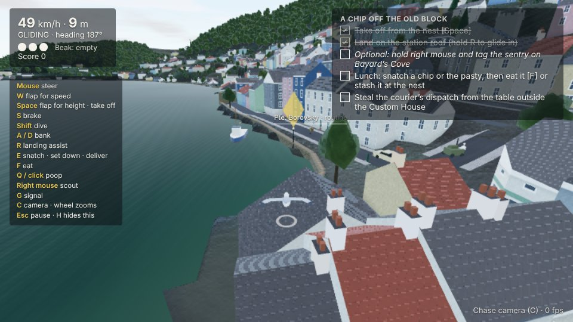
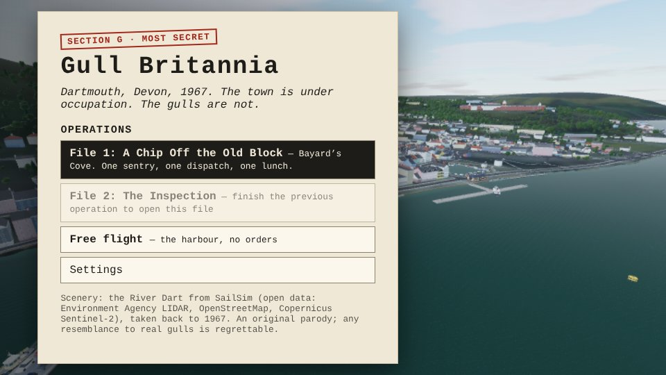
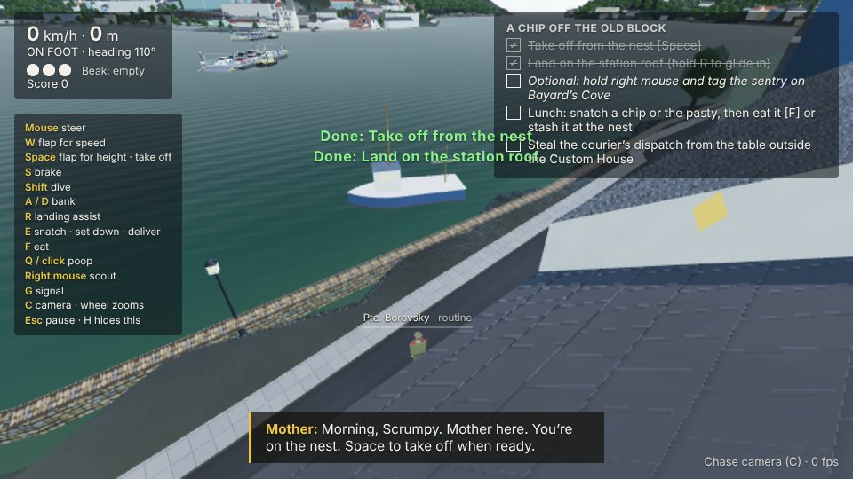
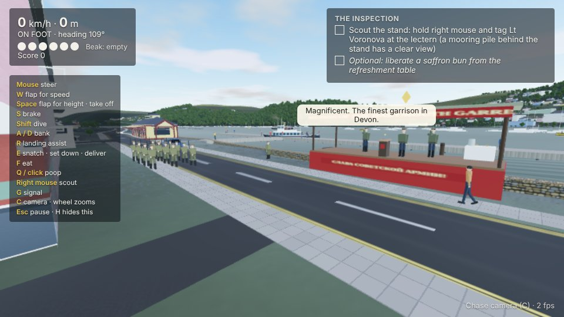
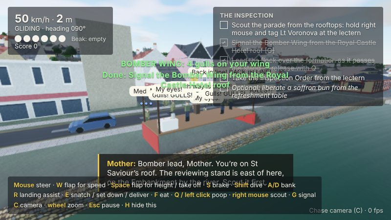

# Gull Britannia

*Dartmouth, Devon, 1967. The town is under occupation. The gulls are not.*

A single-player seagull stealth game in the browser. You are Operative SCRUMPY, a herring gull of the Resistance's Section G, flying over a real, open-data model of Dartmouth and Kingswear, taken back to 1967 and occupied by a slapstick Soviet garrison. Steal lunch, steal dispatches, read the guards' routines, and remember: to them you are just a gull.

The scenery, sky, water, light and rendering are built on [SailSim](https://drdk3.github.io/SailSim/), the River Dart sailing simulator: the same terrain, buildings, quays, woods, tides, haze and water, with the modern harbour taken out.



| | |
| --- | --- |
|  |  |
|  |  |

## Play in your browser

**https://drdk3.github.io/gull-britannia/**

A desktop browser with a mouse is best (Chrome, Edge, Firefox or Safari, with WebGL 2). The first load fetches about 3 MB of River Dart data, then spends a few seconds "surveying the rooftops": it measures every roof the gull can land on. Click the view to capture the mouse; Esc releases it and pauses.

Graphics follow SailSim's presets (Smooth, Balanced, Ultra are picked for your graphics card), and dynamic resolution keeps the frame rate up on slower machines.

## Controls

| In the air | |
| --- | --- |
| Mouse | Steer: the gull flies where you look |
| W | Flap for speed |
| Space | Flap for height (hold it with S to hover) |
| S | Brake: flare the wings and sink gently |
| Shift | Dive: tuck the wings; look down to build speed |
| A / D | Bank turn |
| R | **Landing assist:** glides onto a perch in view, or flares and settles onto whatever is below |
| E | Snatch / set down / deliver |
| F | Eat what's in your beak (you can eat in flight) |
| Q or left mouse | Poop. It keeps your momentum, so height, speed and timing decide where it lands. A ring shows the predicted impact; it turns red and reads **ON TARGET** when the drop will hit a head, a mug or a soldier. |
| Right mouse (hold) | Scout: zoom in, and hold the view on a guard to tag him. Tagged guards show their name, routine, suspicion and vision cone. |
| G | Signal the flock (Mission 2, from the roost) |

| On foot, perched or afloat | |
| --- | --- |
| W A S D | Walk or paddle |
| Space | Take off |

| Anywhere | |
| --- | --- |
| C | Camera: chase (default), first person, scenic, orbit |
| Mouse wheel | Zoom the chase camera |
| Arrow keys | Look (keyboard alternative to the mouse) |
| H or F1 | Show or hide the controls panel |
| Esc or P | Pause: resume, restart, camera, settings, abandon |

**Settings** (title screen or pause menu): mouse sensitivity, invert Y, field of view, master, music and effects volume, **reduced motion** (no camera roll, head bob or shake, a smaller speed zoom, a slower title flight; the system's reduced-motion preference is honoured too), the drop marker, the controls panel, and *Unlock all operations*. Settings and campaign progress are kept in your browser.

## How it plays

- **Flight is forgiving by design.** Stalls always recover, because falling rebuilds airspeed. A hard landing or wall strike sends you into a short tumble, then you flutter back into flight; nothing kills you. Hovering slowly near a perch settles you onto it, and R glides you onto any perch you are looking at. Gulls float, so you can land on the water too.
- **Everything you see is solid.** Roofs, chimneys, quays, walls and treetops are where the picture draws them, so any roof in Dartmouth is a perch and any gap between houses is a way through.
- **One beak slot.** Food scores when you eat it (F) or stash it at the nest (E); stashing adds a Resistance pantry bonus. Chips and pasties earn a bonus. Holding a dispatch and want a snack? Set the dispatch down (E) and come back for it. A guard who sees papers lying about will tidy them back where they belong.
- **To them, you are just a gull.** Guards ignore an ordinary gull on a roof. Suspicion builds when you are near what they guard, carrying papers, or right next to them. A yellow **?** means suspicious, a red **!** means spotted. A guard who spots you chases, swats and throws his cap; a hit knocks out whatever you carry. Break line of sight and he searches where he last saw you, then goes back to his routine, so you can try again.
- **The performance review** scores the objectives, food (with chip and pasty bonuses), poop accuracy and long drops, stealth, clean escapes, reconnaissance and time, and grades you from *Under Review* to the *Distinguished Gull Cross*.

## Campaign

| # | Operation | Status |
| --- | --- | --- |
| 1 | **A Chip Off the Old Block** | **Playable.** Bayard's Cove: flying lessons, lunch, and a dispatch theft with two approaches. |
| 2 | **The Inspection** | **Playable.** The South Embankment: scout the parade, signal the Bomber Wing, lead a mass strike, steal the Inspection Order in the chaos. |
| 3 | Low Tide | Designed, not built (hidden from the menu) |
| 4 | Das Boot, Das Gull | Designed, not built (hidden) |
| 5 | The Dachshund Exchange | Designed, not built (hidden) |
| 6 | The Last Ferry | Designed, not built (hidden) |

The title screen lists only playable operations. Mission 2 opens when you finish Mission 1, or use *Unlock all operations*. **Free flight** gives you the harbour with no orders.

### Mission 1: A Chip Off the Old Block (about 5 minutes)

Take off from the nest on a flat roof above the South Embankment and land on the station roof by the Boat Float. Steal lunch: a chip from the clerk on the Embankment bench, or the pasty cooling on the bakery sill in Bayard's Cove. The dispatch sits on a table outside the Custom House on Bayard's Cove, guarded by Private Borovsky, who works a fixed routine: post, tea, river wall, fort end. Two ways in:

- **Unseen.** Wait on the Custom House gutter; a calm sentry never looks that high. When his routine turns his back (the river wall, the fort end), drop, snatch, and leave over the roofs.
- **Distraction.** From the quay lamp or the *Brixham Lass*'s mast, poop on Borovsky and he goes to the pump to scrub his tunic; poop in his tea and he goes up the lane to the field kitchen for a refill.

Then deliver the dispatch to the lobster pot aboard the *Dorothy May* in the Boat Float.

### Mission 2: The Inspection (about 5–7 minutes)

You fly as **Bomber lead**: a 6-drop payload, a faster reload, slightly wider turns.

1. From St Saviour's roof, find the reviewing stand on the Embankment and tag Lt Voronova at the lectern. A mooring pile in the river behind the stand has a clear view.
2. Signal the Bomber Wing from the Royal Castle Hotel roof, across the Boat Float (G).
3. Lead the Wing along the column as it marches past the stand. The four wingmen fly a tight box matched to the parade's files, and drop when you drop.

Four hits in front of the stand break the formation: soldiers scatter, caps fly, the Colonel comes apart, and Voronova leaves the lectern. Take the Inspection Order to the *Dorothy May*. A mistimed strike leaves the formation intact; the guards start watching the sky, and the Wing flies home to reload.

## Building and running locally

Requires Node.js 22 or later.

```bash
npm ci
```

```bash
npm run dev
```

Open the address it prints. To build the static site into `dist/` (what GitHub Pages serves):

```bash
npm run build
```

```bash
npm run preview
```

## Testing

```bash
npm test
```

Vitest runs the game logic headless (no browser): 25 tests in `tests/gull/`.

| File | What it checks |
| --- | --- |
| `flight.test.ts` | Take-off and climb, flap, glide and dive, stall recovery, brake and hover, landing assist onto a quay and a pitched roof, walking up a roof, wall tumble and recovery, landing on and taking off from water, perching, poop momentum and the drop prediction. |
| `m1.test.ts` | Mission 1 on a stand-in of Bayard's Cove: the flying lesson flown by an autopilot (take off, fly to the station, land); the sentry's routine; the unseen route through delivery, lunch and the review (stealth 300, clean escape 200); the tea and tunic distractions; being spotted, the search and the return; theft discovery and papers put back; carrying papers in view; restart. |
| `m2.test.ts` | Mission 2: the parade's march and turn; tagging Voronova; signalling only from the roost; the flock's box and its drops; a strike in front of the stand breaking the formation, Voronova leaving the lectern, the theft and delivery, and the review; a strike away from the stand; Voronova catching a gull at the lectern. |

```bash
npm run typecheck
```

This checks the browser code and, separately, that the game logic in `src/gull/game` stays DOM-free.

### End to end, in a browser

The unit tests use a simplified stand-in for the town. The end-to-end check loads the real game in headless Chromium (software WebGL works), and an autopilot flies both missions over the real, captured Dartmouth, steering the view and pressing the same controls a player does:

```bash
npm run build
```

```bash
npm run preview
```

Then, in another terminal:

```bash
npm run e2e -- http://127.0.0.1:4173/
```

40 checks, all passing. They cover: the roofs, quays and water are where the picture draws them; Mission 1 flown from the nest to the station roof, waiting unseen on the Custom House gutter for the sentry's back, the snatch, the flight to the Boat Float, the delivery, a chip and the review (grade A, full stealth and clean-escape bonuses); the tea distraction on the real lane; Mission 2 from tagging Voronova to the strike, the theft, the delivery and the review; restart; back to the title. It needs Playwright's Chromium (or set `CHROMIUM_PATH`).

## Project layout

| Path | What it is |
| --- | --- |
| `src/main.tsx` | Entry point |
| `src/gull/game/` | Game logic, DOM-free and deterministic: the world and collision (`world.ts`), the gull's flight (`gull.ts`), guards (`guard.ts`), items, missions (`mission.ts`, `m1.ts`, `m2.ts`, `free.ts`), the parade and the flock (`parade.ts`) |
| `src/gull/view/` | Drawing: the scene and cameras (`gullScene.ts`, after SailSim's `SceneView`), the roof survey (`heightCapture.ts`), 1967 (`era1967.ts`), the gull, people and props |
| `src/gull/app/` | The controller (`game.ts`), sound and music (`audio.ts`), briefings, settings and progress |
| `src/gull/ui/` | The React screens and HUD |
| `src/render`, `src/sim`, `src/app`, `public/geo` | SailSim's River Dart: scenery, sky, water, weather, tides and data, vendored (see `VENDORED.md`) |
| `tests/gull/` | The tests |
| `SOURCES.md` | Research notes, what was changed for 1967, and data attributions |

The first version of the game (Godot 4, a hand-built and compressed Dartmouth) is kept in this repository's history under the tag `godot-v1`.

## Credits and licences

An original parody. The characters, the occupation and the missions are invented. Gulls, people, props, sounds and music are made in code; no third-party art, audio or fonts are included.

The scenery is SailSim's River Dart, built from open data:

- Map data © OpenStreetMap contributors, ODbL 1.0, via Overture Maps Foundation; Microsoft ML Building Footprints, ODbL.
- Terrain © Environment Agency copyright and/or database right 2015. All rights reserved. Open Government Licence v3, via Tilezen terrain tiles.
- Contains modified Copernicus Sentinel data 2025.

Details, and what was removed or changed for 1967, are in `SOURCES.md`.
