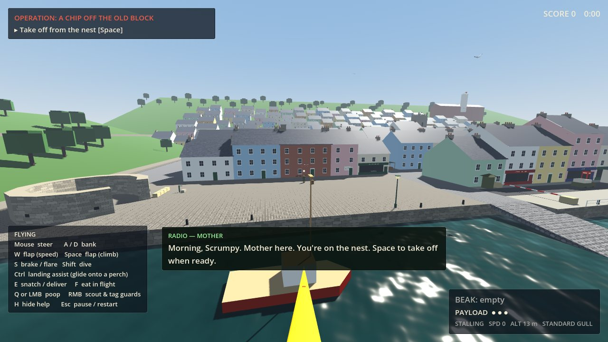

# Gull Britannia

*Dartmouth, 1967. The Soviets hold the Dart. The Resistance has gulls.*

A single-player, first-person seagull stealth game set in an alternate-history Dartmouth, Devon. You are Operative SCRUMPY of Section G, a herring gull trained by the British Resistance to steal intelligence, disrupt the occupation, and relieve it of its lunch.

- **Engine:** Godot **4.7.2-stable** (built and tested with this version), GDScript, **Compatibility** renderer (OpenGL 3).
- **Platform:** desktop, keyboard and mouse.
- **Dependencies:** none. There are no imported assets. Geometry, surface shaders, sound effects and music are all generated in code, so a fresh checkout runs with no editor import step and no manual scene setup.



More screenshots, all captured from the game itself, are in [`docs/screenshots/`](docs/screenshots).

## Play in your browser

**https://drdk3.github.io/gull-britannia/**

It runs in any desktop browser with WebGL 2 (Chrome, Edge, Firefox or Safari), with keyboard and mouse. The first load downloads about 40 MB. Click the game window once and the mouse is captured for steering. Press Esc to release it and pause. Progress saves in the browser.

To rebuild the web version after changing the game, run `tools/build_web.sh`. It uses the `Web` export preset, which is single-threaded so it works on any static host. Then publish the contents of `build/web` to the `gh-pages` branch.

## Launching

1. Install Godot 4.7.x from <https://godotengine.org/download> (the standard build, not .NET).
2. Open the project:
   - **Editor:** *Import*, choose `project.godot`, then press **F5**.
   - **Command line:**

```bash
godot --path /path/to/gull-britannia
```

The game opens on the title screen. **Begin Operations** goes to the next unfinished mission's briefing, then into play.

### Command-line options

Put these after `--`, for example `godot --path . -- --mission=m1 --skip-briefing`.

| Option | Effect |
| --- | --- |
| `--mission=m1` | Go straight to a mission briefing (`m1` or `m2`). |
| `--skip-briefing` | Use with `--mission` to start playing immediately. |
| `--unlock-all` | List every playable operation as unlocked. |
| `--fresh-progress` | Ignore saved progress and don't write any. |
| `--no-music` | Skip music synthesis. |
| `--trace` | Print timing and debug traces. |
| `--autotest=all` | Run the automated checks and quit (see Testing). |

In the browser build, the same switches work as URL parameters, for example `index.html?mission=m1&skip-briefing`.

## Controls

| In the air | |
| --- | --- |
| Mouse | Steer: the gull flies where you look |
| W | Flap for speed |
| Space | Flap for height (hold it with S to hover) |
| S | Brake: flare the wings and sink gently |
| Shift | Dive: tuck the wings; look down to build speed |
| A / D | Bank turn |
| Ctrl (or C) | **Landing assist:** glides onto a perch in view, or flares and settles onto whatever is below |
| E | Snatch / set down / deliver |
| F | Eat what's in your beak (you can eat in flight) |
| Q or left mouse | Poop. It inherits your momentum, so height, speed and timing decide where it lands. A ring shows the predicted impact; it turns red and reads **ON TARGET** when the drop will hit a head, a mug or a soldier. |
| Right mouse (hold) | Scout: zoom in and hold the view on a guard to tag him. Tagged guards show their name, routine and vision cone. |
| G | Signal the flock (Mission 2, from the roost) |

| On foot / perched / afloat | |
| --- | --- |
| WASD | Walk or paddle (Shift to hurry) |
| Space | Take off |
| E, F, Q, right mouse | As in the air |

| Anywhere | |
| --- | --- |
| H or F1 | Show or hide the controls panel |
| Esc or P | Pause menu: Resume, **Restart Mission**, Settings, Abandon |
| Arrow keys | Look (keyboard alternative to the mouse) |

**Settings** (title screen or pause menu): mouse sensitivity, invert-Y, **reduced motion** (removes camera roll, head bob and shake, and limits the speed FOV kick), field of view, master/music/effects volume, the drop marker, the controls panel, fullscreen, and *Unlock all operations*. Settings save to `user://settings.cfg` and campaign progress saves to `user://progress.cfg`.

## How it plays

- **Flight is forgiving by design.** Stalls always recover, because falling rebuilds airspeed. A hard landing or wall strike sends you into a short tumble, then you flutter back into flight; nothing kills you. Hovering slowly near a perch settles you onto it, and Ctrl glides you onto any perch you're looking at. Gulls float, so you can land on the water too.
- **One beak slot.** Food scores points when you eat it (F) or stash it at the nest (E); stashing adds a Resistance pantry bonus. Chips and pasties earn a bonus. If you're holding a dispatch and want a snack, set the dispatch down first (E) and come back for it. A guard who sees papers lying around will tidy them back to where they belong.
- **To them, you are just a gull.** Guards ignore an ordinary gull on a roof. Suspicion builds when you're near what they guard, carrying papers, or right next to them. A yellow **?** means suspicious; a red **!** means spotted. Meters over their heads and arcs around your crosshair show who is watching and from where. A guard who spots you chases, swats, and throws his cap; a hit knocks out whatever you're carrying. Break line of sight and he searches where he last saw you, then returns to his routine, so you can try again.
- **The performance review** scores the objectives, food (with chip and pasty bonuses), poop accuracy and long drops, stealth, clean escapes, reconnaissance and time. It grades you from *Under Review* up to the *Distinguished Gull Cross*.

## Campaign status

| # | Operation | Status |
| --- | --- | --- |
| 1 | **A Chip Off the Old Block** | **Playable.** Tutorial flight and perching, stealing lunch, and a dispatch theft with two approaches. |
| 2 | **The Inspection** | **Playable.** Scout the parade, signal the Bomber Wing, lead a mass strike, and steal the Inspection Order in the chaos. |
| 3 | Low Tide | Designed, not built (hidden from the menu) |
| 4 | Das Boot, Das Gull | Designed, not built (hidden) |
| 5 | The Dachshund Exchange | Designed, not built (hidden) |
| 6 | The Last Ferry | Designed, not built (hidden) |

The menu only lists playable operations. Mission 2 unlocks when you complete Mission 1, or use *Unlock all operations* in Settings.

### Mission 1: A Chip Off the Old Block (about 5 minutes)

Take off from the nest, land on the station roof, then steal a chip from the clerk on the Embankment or the pasty cooling on the bakery sill. The dispatch sits on a table outside the Harbour Office in Bayards Cove, guarded by Private Borovsky. He works a fixed routine: post, tea, river, fort. There are two ways in:

- **Unseen.** Wait on the Harbour Office gutter or chimney; a calm sentry never looks that high. When his routine takes him to the river or the fort, drop, snatch the dispatch, and leave over the roofs.
- **Distraction.** From the quay lamp or the *Brixham Lass*'s mast, poop on Borovsky and he walks to the pump to scrub his tunic. Poop in his tea and he goes up the lane for a refill, where the bakery blocks his view of the table.

Then deliver the dispatch to the lobster pot aboard the *Dorothy May* in the Boat Float.

### Mission 2: The Inspection (about 5–7 minutes)

You fly as **Bomber lead**: a 6-drop payload, a faster reload, and slightly wider turns.

1. From the Butterwalk roof, tag Lt Voronova at the lectern.
2. Signal the Bomber Wing from the Royal Castle Hotel roof (G).
3. Lead the Wing over the parade as it passes the reviewing stand. The four wingmen fly a tight box matched to the parade's files, and they drop when you drop.

If you land four hits in front of the stand, the formation breaks: soldiers scatter, caps fly, the Commandant comes apart, and Voronova leaves the lectern to restore order. Take the Inspection Order to St Saviour's belfry. A mistimed strike leaves the formation intact; the guards start watching the sky and the Wing flies home to reload.

## Testing

### Automated checks

```bash
godot --headless --path . --fixed-fps 60 -- --autotest=all --fresh-progress --no-music
```

This prints PASS/FAIL per check and exits non-zero on any failure. All 125 checks pass on Godot 4.7.2 (about 26 seconds headless). Most suites place the gull directly to test one system at a time. The `pilot_*` suites never teleport it: the bot steers by turning the view like a mouse and presses the same actions a player does. Suites:

| Suite | What it checks |
| --- | --- |
| `boot` | Mission launches with no manual setup. |
| `flight` | Takeoff, climb, flap speed, level glide, dive, stall recovery, brake/flare, hover, landing assist, walking, re-takeoff, crash, tumble and recovery, water landing and takeoff. |
| `perch` | Landing assist onto the station roof, slow-hover auto-perch, scouting and tagging. |
| `food` | Chip eaten with bonus, pasty stashed with bonus and pantry, beak-slot set-down and swap, re-pickup. |
| `m1_unseen` | The full unseen route through delivery, completion, the results screen and the stealth bonus. |
| `m1_distraction` | A poop hit sends him to the pump; the dispatch is taken unseen; he returns and discovers the theft. |
| `m1_tea` | Tea hit, refill trip, line of sight blocked, unseen theft. |
| `m1_spotted` | Spotted at the table, knocked loose, recovered, line of sight broken, search, return to routine; he tidies a loose dispatch. |
| `restart` | Objectives, score, pickups, guard behaviour and gull position all reset; restart from the pause menu. |
| `settings` | Invert-Y, mouse sensitivity, reduced motion. |
| `m2` | Bomber profile, scouting, the flock signal, a led strike breaking the formation, the chaos opening, theft, delivery and scoring; a mistimed strike holds. |
| `pilot_unseen` | Flies the whole unseen route with real flight physics: takeoff, station landing, an in-flight chip snatch, the gutter perch, waiting out the routine, hopping off to snatch the dispatch, a low escape, and delivery from a hover. |
| `pilot_distraction` | Flies a lined-up bombing run, releases on ON TARGET, hits the sentry, takes the dispatch while he scrubs, and delivers unseen. |

Add `--shots=/some/dir` and run with a display (or under `xvfb-run`) to save screenshots. `--autotest=tour` captures a visual tour of the title, briefing, operations, harbour vantage points, the HUD in a suspicion moment, the performance review, and the parade before and after a strike.

### Manual checks still needed

The automated runs drive the real systems with scripted inputs and, under Xvfb, render real frames. A human playthrough is still needed for:

- **Mouse flight feel.** Steering response, turn rate, dive speed and landing difficulty with a real mouse at several sensitivities.
- **Both Mission 1 routes, flown by hand.** Wait out the routine from the gutter; hit the tea or the tunic from the lamp or the mast.
- **Being spotted, flown by hand.** Is the thrown cap readable and dodgeable? Do the suspicion meters and arcs read clearly?
- **Mission 2's strike, flown by hand.** Is four hits in front of the stand the right difficulty when flying along the column at speed?
- **Restart** from the pause menu and from the review screen, mid-mission, by hand.
- **Audio balance** of the synthesised music and effects. Headless and Xvfb runs use the dummy audio driver, so no sound was heard during development. The cues were exported to WAV and checked numerically only: music at -14 to -17 dB RMS, no clipping.
- **Performance on real GPUs.** Development rendering used software OpenGL (llvmpipe) and software WebGL (SwiftShader).
- **The browser build on real browsers.** Development tests ran in headless Chromium only. The `boot`, `food`, `m1_tea`, `restart` and `m2` suites also pass inside the browser build (`index.html?autotest=...`). Check that pointer lock behaves well in Firefox and Safari.

## Project layout

```
project.godot              Compatibility renderer, autoloads, window settings
scenes/main.tscn           Root node (script-driven)
scripts/core/              game.gd (settings, saves, input map, mission roster)
                           sfx.gd (procedural SFX + music), main.gd (screen flow)
scripts/player/            gull.gd (flight model, camera, beak), poop.gd
scripts/actors/            guard.gd (suspicion AI), people.gd (primitive figures),
                           diner.gd, marcher.gd, ally_gull.gd, figure.gd, thrown.gd
scripts/world/             dartmouth.gd (the town), builder.gd (batched geometry),
                           palette.gd (materials + shaders), ferry.gd, beak_item.gd,
                           perch.gd, drop_point.gd, gull_model.gd, ambient_gull.gd
scripts/missions/          mission.gd (shared rules, scoring), m1_chip.gd,
                           m2_inspection.gd, briefings.gd
scripts/ui/                hud.gd, menus.gd, ui_theme.gd
tests/autotest.gd          Automated checks and screenshot tour
tools/build_web.sh         Browser export (Web preset in export_presets.cfg)
docs/screenshots/          Captures from the screenshot tour
SOURCES.md                 Research notes, approximations, attribution
```

To add a mission, extend `scripts/missions/mission.gd`, override `_setup()` (build the world, then call `spawn_gull`, `add_guard`, `add_item`, `add_drop`, `add_perch`, `add_objective`) and `_mission_tick()`, add a briefing to `briefings.gd`, and register it in `Game.MISSIONS` with `playable: true`.

## Next playable increment: Mission 3, *Low Tide*

- **Strafing-gull handling profile:** fast and agile, with a low-altitude bonus (less drag within about 4 m of the water) and a rapid-release payload.
- **A strafing course just above the river:** foul the inspection flags and clipboards on a Soviet inspection launch and the pontoons (new poop targets).
- **Draw a patrol boat away from the Resistance ferry.** The patrol boat gets a Guard-style suspicion AI on water; the Resistance ferry reuses `ferry.gd`.
- **Occupation escalation:** extra patrols on the Embankment, nets on the hotel roof, and a more frantic Commandant on the radio.
- **Side mission candidates:** tail a courier from rooftop perches; catch windblown pages; navigate in fog (`fog` is already a world option).
