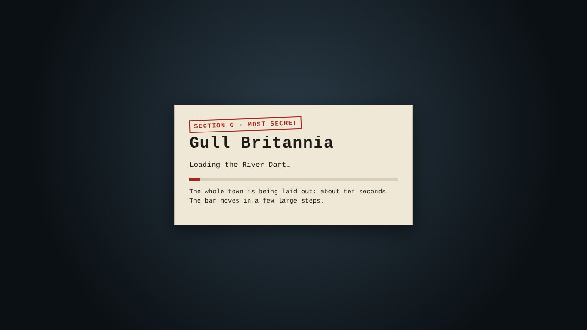
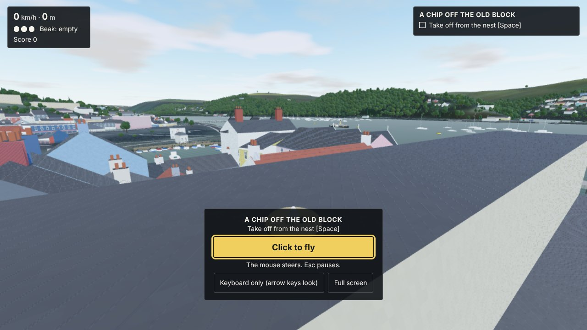
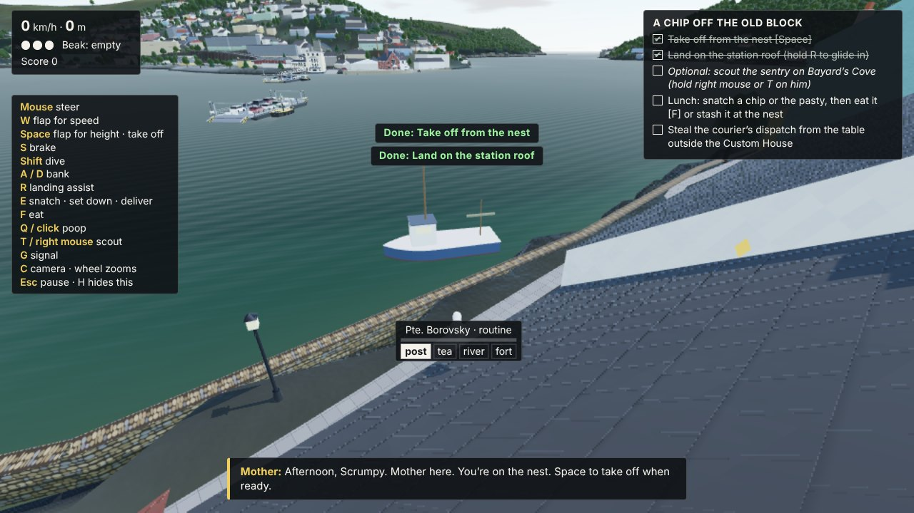
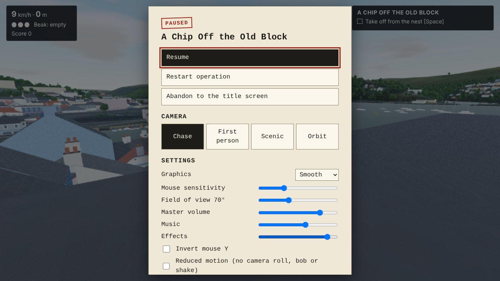
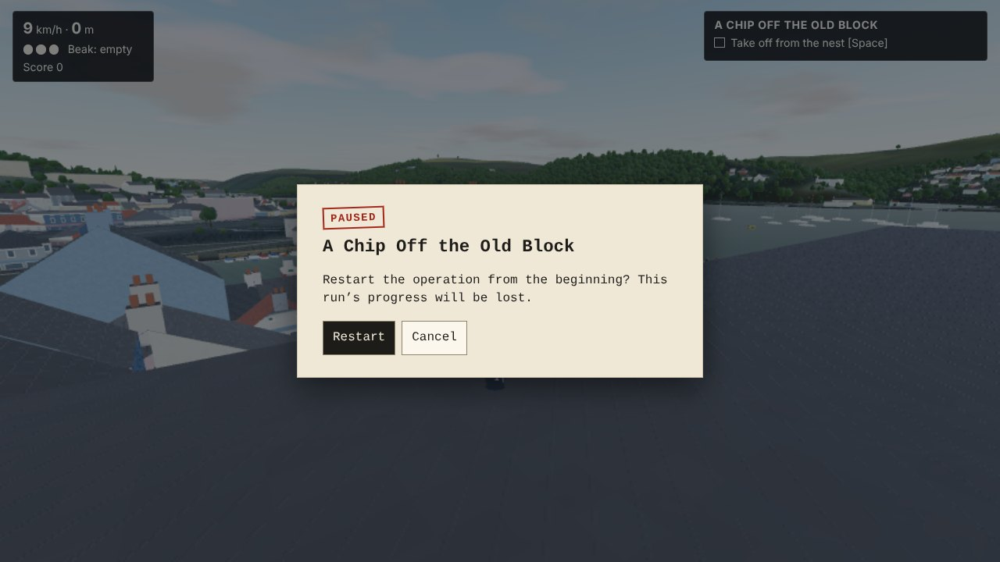
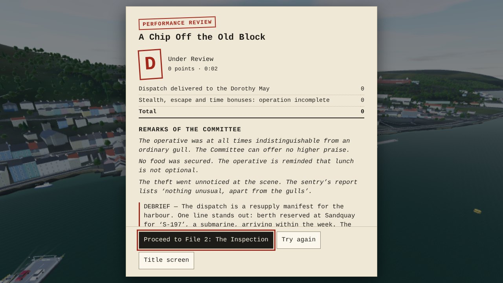
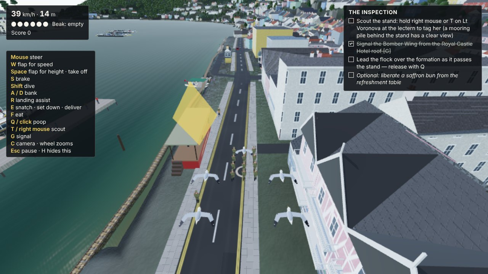
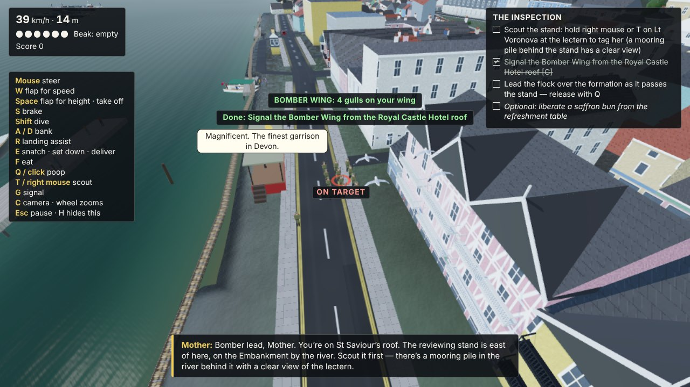
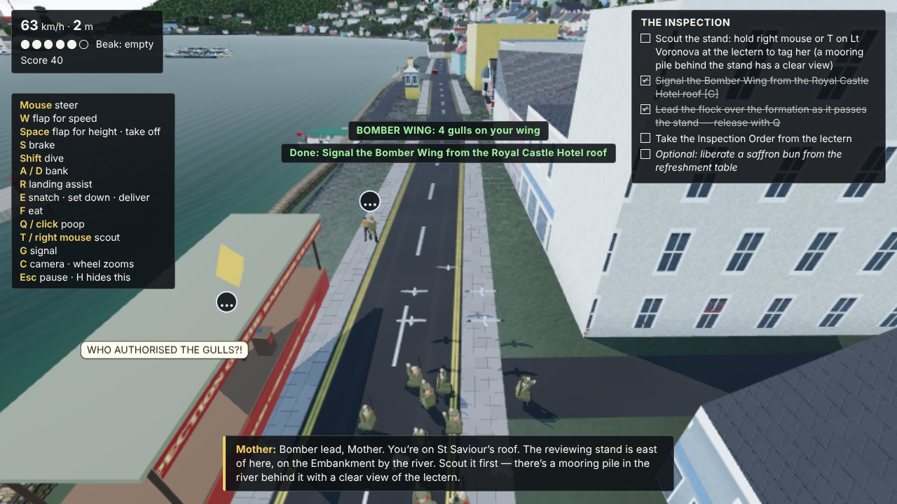

# Gull Britannia 2.1, "Mission 1, launch-ready": milestone report

A running record, one section per work package. Goal of the milestone: a stranger finishes Mission 1, laughs, and shares the result.

| Package | Status |
| --- | --- |
| 1. Front door and safety net | Done |
| 2. Stage 0 correctness | Done; **stopped here for the owner's review** |
| 3. The first 60 seconds of Mission 1 | Not started |
| 4. Make the stealth fantasy pay off | Not started |
| 5. Juice and a shareable moment | Not started |
| 6. Launch kit and measurement | Not started |

## Package 1: front door and safety net

**Changed.** `main` now carries the browser game (fast-forwarded from `sailsim-engine`; no history was rewritten). ESLint with a flat config and `npm run lint`, including a rule that keeps `src/gull/game/` free of browser code. GitHub Actions runs the type check, lint, unit tests, build and browser suites on every push, and deploys `main` to GitHub Pages without source maps (`sourcemap: 'hidden'`). MIT licence. Full attribution on the title screen's Credits card.

**Not as specified.** The tag `godot-v1` could not be pushed from the cloud session (tag pushes are refused with HTTP 403). The Godot version is preserved as the branch `godot-v1-archive` instead. The owner can add the tag in two minutes (see "Needed from the owner").

## Package 2: Stage 0 correctness

**Plan, as written before starting.**

1. Fix collision: the finest grid decides; re-place every perch and prop on what is now solid; test with two overlapping grids.
2. Bake the collision grids at build time, load them at run time, keep the in-browser survey behind `?survey`, and time the load before and after.
3. Make the frame honest: draw every moving thing between simulation steps, hang the carried item from the bill, pin labels every frame; give each mission its own clock, tide and sky.
4. Put the player in control before anything starts: a Ready gate, pause and resume that release and recapture the mouse, scouting on a key, no debug readout.
5. Mission 2: wingmen that hold their slots, a drop marker that leads the column, and a pilot test flown with the player's inputs only. Then the 1967 quick corrections.

**What changed.**

| Area | Change |
| --- | --- |
| Collision | `World` sorts its grids finest first, so the 0.5 m grid over the old town is used at last (the 2 m grid had been answering every query). Perches, the sentry's river stop, the lamp, the bench, two crusts and Mission 2's stand were moved onto what is actually solid. |
| Bake | `npm run bake:collision` renders the scenery from above in headless Chromium and writes `public/geo/collision-*.i16z` (1.08 MB together, in SailSim's packed-grid format). The game loads them; `?survey` measures in the browser as before. |
| Drawing | Guards, soldiers, the Wing, thrown caps, drops and the gull are drawn between simulation steps. The carried item hangs from the bill. Labels are positioned every frame, not ten times a second. |
| The day | Each mission has its own date, time, wind, tide and sky (`MissionConditions`), restored on restart and on returning to the title. Mission 1's tide is now a neap (3 June 1967 was three days after the last quarter). Mother says "Afternoon" at 13.20. |
| Control | A Ready gate: the scene is shown, and nothing runs until the player clicks to capture the mouse or chooses Keyboard only. Esc pauses and releases the mouse; Resume recaptures it; Esc again steps back to the gate. Losing focus or hiding the tab pauses. Restart and Abandon ask first. |
| Scouting | `T` scouts as well as the right mouse button. The hint now arrives within 120 m and in sight of the sentry, not 317 m away behind a roof. A tagged guard's routine is drawn as steps with the current one marked. |
| HUD | Every HUD text sits on a solid dark plate (contrast 13:1 or better) and is 16 px on a 1080-line screen. The fps and camera line shows only with `?debug`. Toasts rise in place; they no longer slide across the screen. |
| Menus | Title, dossier, pause and review are dialogs: focus goes in, Tab stays in, Esc closes, focus returns. The dossier's Begin button stays in view. The review offers "Proceed to File 2". Errors are readable and offer Try again. |
| Mission 2 | Wingmen fly the leader's velocity plus a correction, and sit 0.2–0.3 m from their slots at cruising speed (they trailed by 3.4–4.8 m). On the leader's release each wingman lets go as it passes over its own mark, laying a box around the leader's. Targets report their velocity and the ON TARGET marker tests them where they will be when the drop lands. |
| Camera | The chase camera rides up over a roof slope behind the gull. With the fine grid in use it had begun to collapse into the gull on the Custom House gutter, the main stealth perch. |
| Robustness | A lost graphics context pauses the game and the sky is rebuilt when it returns. Mission shaders compile during the briefing. Splats are one instanced mesh; restart frees what the last run made. Sound no longer bursts after a hidden tab. Near plane 0.25 m (0.05 m in first person). |
| 1967 | Only the filling station's Spar is removed (two shops in town share the name). The pontoon kept by mistake as the "Kingswear ferry landing" and Double Steps Pontoon are gone. The tourist office (1993), the Marks & Spencer block (1995–96), the Hoodown depot, the training ship *Hindostan* (1992) and the heritage steam train (1973) are left out. Dart Marina is documented as kept: it opened in 1965. `SOURCES.md` corrected. |

**Tests.** All pass.

| Check | Result |
| --- | --- |
| `npm run typecheck` | Clean (browser code, and the DOM-free check on `src/gull/game/`) |
| `npm run lint` | Clean |
| `npm test` | 38 of 38 in 6 files (28 before) |
| `npm run build` | Clean |
| `npm run e2e` | 70 of 70 in 2 suites: `gate` 28, `missions` 42 (40 in one suite before) |

New tests:

- **Two overlapping grids** (`world.test.ts`): the fine grid decides heights, collision and sight lines, whichever order the grids are given in.
- **The pilot** (`m2pilot.test.ts`, `pilot.ts`): flies Mission 2 with the player's inputs only: rate-limited mouse look, the control keys, Q and G. It walks to the eaves and scouts, flies to the hotel roof and lands with R, signals, and bombs the column, releasing whenever the marker reads ON TARGET. The formation breaks flying with the march and against it, at 9, 14, 18 and 20 m, and along either outer file. Without the Wing the same two drops do not break it. On the previous follow logic four of the five tests fail.
- **The gate** (`gate.e2e.cjs`): real clicks and keys in the browser. At the gate the mission clock, the day's clock and the tide stand still; a click captures the mouse and starts the mission; Esc pauses and frees the mouse; Resume recaptures it; Restart returns the clock to 13.20 and the tide to its start; `T` scouts; the readout appears only with `?debug`.
- **The strike on the real town** (`missions.e2e.cjs`): the autopilot now flies the pass over the real Embankment instead of having hits placed for it: leader 2 hits, Wing 9.
- **The 1967 list** (`era1967.test.ts`) against the real map data.

**Load time**, page open to title screen, headless Chromium with software rendering at 1280×720 (the e2e machine), median of three runs:

| Build | To title |
| --- | --- |
| Before the bake (survey in the browser) | 11.2 s |
| After the bake | 9.3 s |
| End of package 2 | 10.6 s, against 10.0 s for the bake commit re-measured in the same session (the machine was running slower; runs differ by about 0.7 s) |
| End of package 2 with `?survey` | 12.4 s |

The bake saves about two seconds. What remains is building the scene (about 4.6 s) and compiling shaders (about 3.5 s).

Two regressions were caught by measuring and fixed before this report. An animated loading bar, added so that the loading screen could not look frozen, nearly doubled the load on a software renderer (17 s): the compositor competed with the scene build. It is now a bar that moves in four steps. And setting the day's sky before the town existed built the sky's environment map twice (about one second).

**Screenshots** (headless Chromium, software rendering, 1280×720), in `docs/screenshots/2.1/`:

| | |
| --- | --- |
|  The loading card, with the stepped bar |  The Ready gate: nothing runs yet |
|  On the Custom House gutter: plates, and the sentry's routine with its playhead |  The pause menu, focus on Resume |
|  Restart asks first |  The review offers the next file |
|  The Wing on its slots over the column |  ON TARGET: the ring sits ahead of the front rank, where the men will be when the drop lands |
|  Formation broken | |

The Mission 2 pictures were taken with the game stepped by a script and the gull placed for the camera. That is why the banner is missing from the last one and Mother is still on her first line: messages run on the frame clock, which crawls at about one frame a second under software rendering at this size.

**Known issues**, all in `reports/backlog.md`: the Wing's footprint is not drawn on the ground (M2-1); the Ready card covers the gull (F-1, rebuilt in package 3); mission text still names keys (F-3, package 3); lost-context handling has no automated test (F-5).

**Needed from the owner.**

1. **Review this package on the live site** before package 3 starts.
2. **The tag.** GitHub → Releases → Draft a new release → tag `godot-v1`, target `godot-v1-archive` → Publish.
3. **Mission 2's hour** (backlog D1). At 10.55 on 7 June 1967 the tide was probably low and the Boat Float nearly dry. Move the parade to the evening, move the drop, or leave it. Not urgent: the milestone is about Mission 1.
